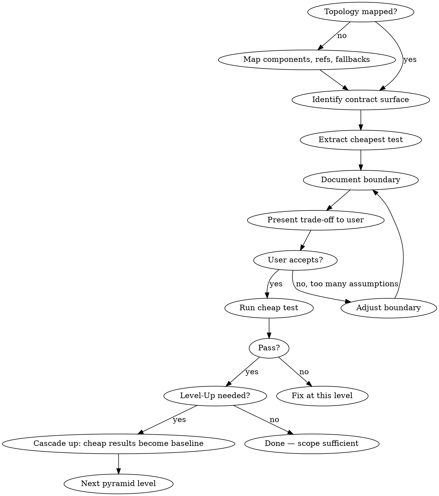

# DevOps Engineer — Test Pyramid Cascade

> Worked examples reference [DevCell](https://github.com/devcell-sh/devcell) paths and modules (`managed-mcp.nix`, `patchright-mcp-cell`, `/opt/npm-tools`). Adapt to your container setup.

## Overview

Shift-left testing for infrastructure. Find the cheapest way to get confidence in a change before spending expensive cycles (image rebuilds, container restarts, MCP reconnections).

**Core principle:** Every test decision is a trade-off between three dimensions — **Cost**, **Level**, and **Scope**. Navigate the pyramid from cheap to expensive, where each level inherits proven baselines from below.

## When to Use

- Infrastructure change needs validation (nix package, Dockerfile, MCP config, terraform)
- Existing E2E test is too expensive for the iteration cycle
- You're about to `task image:build` — stop and ask: can I validate this cheaper?
- A test is failing and you need to isolate which layer is broken
- Adding a new component that will integrate into an existing pipeline
- **User asks to run or test something** — discover available tests, classify by level/cost, present the pyramid table BEFORE executing. Let the user pick the level.

## When NOT to Use

- Application-level business logic testing (use standard TDD)
- One-off manual verification you won't repeat

## The Three Dimensions

| Dimension | Question | Example |
|-----------|----------|---------|
| **Cost** | Time/resources per iteration? | `node bot-detect-test.js` = 30s vs `task image:build` = 30min |
| **Level** | Where on the pyramid? How close to production? | L1 (isolated) = fast, narrow; L3 (pipeline) = slow, full fidelity |
| **Scope** | What's inside vs outside this test's concern? | "Proves bot detection. Does NOT prove nix integration or image build." |

**Always ask:** Is it cheaper to run the isolated test 100 times or the full build 100 times?

## Core Process



### Step 0: Announce the Pyramid Analysis

**Trigger:** This step runs **before any test execution** — including when the user asks to "run tests", "test X", "verify Y", or "check if Z works". Do not execute tests without presenting the pyramid first.

**What to do:**
1. **Discover** all available tests for the concern (grep test files, check `test/`, `test/js/`, Go test functions)
2. **Classify** each test by level (L1/L2/L3) and estimate cost
3. **Present** the full table to the user so they can pick the right level
4. **Wait** for the user to choose before running anything

**Level definitions:**

Every level has at least two steps: **gate** (static validation — "does it even parse?") then **execute** (run the actual test). If the gate fails, don't waste cycles on execution.

| Level | Name | Gate (static) | Execute | Cost profile |
|-------|------|--------------|---------|-------------|
| L1 | Isolated execution | Syntax check the source (`node --check`, `bash -n`, lint) | Run the component directly using the contract surface | Seconds to minutes |
| L2 | Build system | Parse/validate build config (`nix-instantiate --parse`, `tofu validate`) | Build the artifact, verify packaging/paths | Minutes |
| L3 | Full pipeline | Lint Dockerfile, validate compose config | Image build + container start + runtime validation | 10-30+ min |

**Announce format:**

```
Applying test pyramid analysis for: [change description]

Available tests:
| Level | Test | Command | Cost | What it proves |
|-------|------|---------|------|----------------|
| L1 | [name] | [command] | [time] | [scope] |
| L1b | [name] | [command] | [time] | [scope] |
| L2 | [name] | [command] | [time] | [scope] |
| L3 | [name] | [command] | [time] | [scope] |

Recommendation: Start at L[N] because [reason].
```

**Not all levels apply to every change.** Some changes only have L1 and L3 (no meaningful L2). Be explicit about which levels exist and which are skipped.

**Separate pyramids for separate concerns.** If the change spans multiple domains with different infrastructure requirements, each domain gets its own pyramid. For example:
- **Pyramid A (browser stealth):** L1=bot-detect-test.js → L2=nix build wrapper → L3=full image
- **Pyramid B (system libraries):** L1=nix build profile → L2=docker image layer → L3=full image

These pyramids share L3 (both converge at the full image build) but have completely different L1-L2 tests with different contract surfaces and scope limitations. Do not conflate them — test each concern through its own pyramid.

### Step 1: Identify the Contract Surface

Find the minimal shared interface between the component under test and its integration point. This is the seam where you can extract a test.

**Example — MCP bot detection:**
- Full pipeline: nix builds `patchright-mcp-cell` wrapper -> image includes it -> MCP server starts -> chromium launches with flags -> init-script injected -> page renders
- Contract surface: `chromium --use-gl=angle --use-angle=swiftshader ... + init-script content`
- If the isolated test uses the **exact same** launch args and init-script, results transfer to the integrated system

**How to find it:** Trace the call chain from the E2E test inward until you hit the boundary where "our code" meets "their code" or "config" meets "runtime." That boundary is the contract surface.

### Step 2: Extract the Cheapest Test

Build a standalone script that exercises just the contract surface. Requirements:
- Uses identical parameters as the integrated system (same flags, same config)
- Runs without image rebuild, container restart, or MCP reconnection
- Produces structured, comparable output (JSON, exit codes)
- Can run on the current system (assumes env is already set up: display, libraries, etc.)

### Step 3: Document the Scope

**Mandatory.** For every extracted test, explicitly state:

**This test proves:**
- [What the test validates]

**This test does NOT prove (out of scope):**
- [What's outside the concern boundary]

**Environment assumptions:**
- [What must already be present: X11, DISPLAY, fluxbox, node, specific packages]

**Contract surface match:**
- [How the test params match production — identical? subset? approximation?]

### Step 4: Present Trade-off to User

Before running, present the cost/level/scope analysis and let the user decide what's acceptable. Format:

```
Test: bot-detect-test.js (isolated)
Cost: ~30s per run
Level: L1 (integration) — exercises contract surface directly
Scope: Bot detection scoring only. Out of scope: nix packaging, MCP stdio, image-level concerns
Assumptions: patchright npm package at /opt/npm-tools, DISPLAY set, swiftshader libs present
Contract surface: Chrome args + init-script identical to patchright-mcp-cell wrapper

Recommendation: Run isolated first. Level up to image build only if:
  - Init-script loading mechanism changes
  - Chrome args diverge from wrapper config
  - Need to validate nix packaging of the wrapper
```

### Step 5: Level Up

When the cheap test passes, its results become **baseline assumptions** for the next pyramid level.

Every level has two phases:
1. **Gate** — static validation: does the artifact at this level even parse? (seconds, zero side effects)
2. **Execute** — run the actual test at this level

The gate is not a separate level — it's built into every level as the cheapest possible sanity check before spending cycles on execution.

**Level-up sequence:**
1. Current level passes
2. **Consult the topology** (`docs/components/<domain>/`) — what references this artifact at the next level? Content-addressed hash, PATH, auto-discovery? This determines what "promote" means.
3. Promote artifact to the source location the next level reads (Step 6)
4. Next level's **gate**: does the changed source parse/validate?
5. Next level's **execute**: run the actual test

**Example — leveling up from L1 to L2:**
1. L1 passes: `bot-detect-test.js` confirms stealth works
2. Promote: copy init-script changes into nix module
3. L2 **gate:** `nix-instantiate --parse managed-mcp.nix` — does the nix module parse?
4. L2 **execute:** `nix build .#patchright-mcp-cell` — does it package correctly?

**Common gates per domain:**

| Domain | Gate command |
|--------|------------|
| Nix | `nix-instantiate --parse`, `nix eval` |
| Shell | `bash -n`, shellcheck |
| Docker | Dockerfile lint, `docker build --check` |
| JavaScript | `node --check` |
| Terraform | `tofu validate`, `tofu fmt -check` |

**Baseline inheritance:**
- L1 (isolated): gate: syntax valid → execute: patchright + init-script + chrome flags pass bot detection -> **proven**
- L2 (build): gate: nix module parses → execute: wrapper bundles init-script correctly -> tests packaging, **assumes L1 works**
- L3 (pipeline): gate: dockerfile valid → execute: full image build + container + MCP -> tests full pipeline, **assumes L1-L2 work**

The expensive test doesn't re-validate what the cheap test already proved. It focuses only on the integration glue at its own level.

### Step 6: Integrate Changes Upward

When a cheap test proves a change works, that change must be **promoted into the real system** before leveling up. The isolated test used a local copy (e.g., `/tmp/stealth-init.dev.js`); now the change needs to land where the integrated system expects it.

**Integration path per level:**

| Proven at | Promote artifact to | Then validate at |
|-----------|---------------------|-----------------|
| L1 (isolated) | Source location the build system reads (nix module, Dockerfile, config) | L2 |
| L2 (system build) | Ready for full pipeline validation | L3 |

**Example — init-script iteration:**
1. L1 passes with `./stealth-init.dev.js` (local working copy)
2. **Promote:** Apply proven changes to `nixhome/modules/managed-mcp.nix` (the source location nix reads)
3. **Validate at L2:** `nix build` the wrapper — confirms nix packages it at the expected path
4. **Validate at L3 (if needed):** `task image:build` — confirms full pipeline

**Key rule:** Never skip promotion. A passing L1 test against a temp file is not done — the change isn't real until it lives where the build system reads it. Git workflow is outside this skill's concern.

## Contract Surface Reconciliation (Downward Sync)

The pyramid flows upward, but the **integrated system can change above you**. When a higher level changes (new library installed, chrome flags updated in the nix wrapper, entrypoint restructured), lower-level tests may silently drift out of sync — their contract surface no longer matches production.

**When to reconcile:**
- Before running an existing L1-L2 test after time has passed
- After any change to a component that sits *above* the test's level
- When a cheap test passes but the integrated system behaves differently

**How to reconcile:**
1. **Walk the topology** (`docs/components/<domain>/`) — for the component under test, follow its reference chain. Every link in the chain is a potential drift point. Content-addressed references (nix hashes, digests) are highest risk.
2. **Compare the contract surface** — diff the parameters your cheap test uses against what the integrated system actually passes. The topology tells you *where* to look for each parameter's source of truth.
3. **Check environment assumptions** — has a new dependency been added? Has a path changed? Does the test assume a library version that's been updated?
4. **Update or invalidate** — if the surface has diverged, update the cheap test to match, or mark it as stale and re-extract from the current integrated system

**Example — downward sync trigger:**
- Nix module adds `--disable-gpu-compositing` to chrome flags
- `bot-detect-test.js` still uses the old flag set
- L1 test passes but the real MCP pipeline now behaves differently
- **Fix:** Pull the updated flags from the nix module into the test script

**Red flag:** A cheap test that hasn't been reconciled in a while is giving you **false confidence** — it's testing a contract surface that no longer exists.

### Proactive Drift Detection

Don't wait for a failure to discover drift. Each kept test should declare its contract surface in a machine-readable way so drift can be detected automatically.

**Practice:** In each kept test's comment header, declare the source of truth for its contract surface parameters:

```
// Contract surface source of truth:
//   CHROME_ARGS: nixhome/modules/managed-mcp.nix (chromiumArgs array)
//   init-script: nixhome/modules/managed-mcp.nix (stealth-init.js content)
//   chrome binary: <path to the chromium your MCP browser launches>
```

**Before running any kept test**, compare declared parameters against their source of truth:
1. Extract the test's contract surface (args, paths, env vars, hashes)
2. Extract the current source of truth from the level above
3. Diff — if diverged, reconcile before running

**For content-addressed references** (nix hashes, docker digests): a simple `test -e <path>` catches stale hashes that no longer exist in the store. A deeper check diffs the referenced artifact's content against what the current build produces.

**When this catches real problems:**
- nix rebuild changed a store hash → config still references old hash → `test -e` fails → drift detected before a false pass
- Chrome flags updated in nix module → test still uses old array → diff shows mismatch → reconcile before running

**Integration with level-up:** Drift detection is a pre-flight step. Before leveling up, run drift detection on all kept tests at the current level. Stale tests give stale baselines — leveling up on a stale baseline propagates false confidence upward.

## Correctness Attribution

A passing test is only meaningful if you can trace *why* it passes to something proven at that level. If it passes for a different reason — a fallback, cached state, auto-discovery, or external change — the pyramid has a gap.

**After every pass, ask:** "Is this passing because of what I changed, or because of something else?"

### Silent Drift

The most dangerous pyramid gap is a test that passes *despite* a stale contract surface. This happens when a component has a fallback or auto-discovery mechanism that compensates for incorrect config.

| Symptom | What's actually happening | Gap |
|---------|--------------------------|-----|
| Config has stale paths but runtime works | Fallback/auto-discovery masks stale references | Gate missing: "do referenced paths resolve to current artifacts?" |
| Test passes with env var from a previous session | Leaked state, not the current system | Scope doc missing: assumption about env lifecycle |
| Build succeeds from cached derivation | Not evaluating current source | Execute not forcing fresh eval |
| External service changed behavior, test still passes | External dependency drifted | Contract surface includes external state that isn't pinned |

**The fix is always the same:** add a gate or scope check that validates *why* the pass happened, not just *that* it passed.

### Content-Addressed Reference Validation

Any config that contains content-addressed references — nix store hashes, docker image digests, version pins, lockfile entries — needs a gate that verifies references resolve to **current** artifacts, not stale ones.

**Pattern:** After any build that produces new content-addressed artifacts, check that configs referencing those artifacts have been updated.

```
L2 gate (general):
  1. Parse/syntax check (existing)
  2. Resolve all content-addressed references in config
  3. Verify each reference points to a current artifact (not a prior build)
```

**Example — nix store hashes in MCP config:**
- `claude.json` references `/nix/store/<hash>-stealth-init.js`
- After `nix build`, the hash changes
- L2 gate should verify: does the hash in config match the hash `nix build` just produced?
- If not: config is stale. The wrapper may auto-discover the correct file anyway, but the config is wrong.

### Fallback-Aware Scope Documentation

When documenting scope (Step 3), explicitly list known fallback mechanisms in the component under test. If the test exercises a fallback path instead of the primary path, say so.

**Extended scope template:**

```
This test proves:
  - [what it validates]

This test does NOT prove:
  - [what's outside scope]

Known fallback mechanisms:
  - [component X falls back to Y when Z fails]
  - [this test exercises: primary path / fallback path / both]

Environment assumptions:
  - [what must be present]
```

If you can't tell whether the test is exercising the primary path or a fallback, that's a red flag — the test's correctness attribution is ambiguous.

## Level-Up Criteria

**Hard rule: No level-up on a drifted contract surface.** If drift detection finds a mismatch between a test's contract surface and its source of truth, you must reconcile and re-verify at the current level before leveling up. A drifted baseline propagates false confidence — every level above inherits an assumption that was never actually proven.

Move up the pyramid when:
- Contract surface has **diverged** (cheap test uses different params than production)
- Change touches **integration glue**, not just the isolated component
- An assumption from a lower level has been **invalidated** (e.g., nix wrapping changed how init-script is loaded)
- You need to validate **environment-level concerns** (package availability, path resolution, permissions)

Stay at current level when:
- Contract surface is identical
- Change is contained within the component boundary
- Lower-level baselines haven't changed

## Component Topology Mapping

Before pyramid analysis, map the system you're testing. Without a topology, you'll miss contract surfaces, overlook fallback mechanisms, and misjudge which level a concern belongs at.

### What to Map

For each component in the pipeline, capture:

| Aspect | Question | Example |
|--------|----------|---------|
| **Binaries** | What executables does the build produce? What do they wrap? | `patchright-mcp-cell` wraps `mcp-server-patchright` |
| **Configs** | What config files wire components together? Who generates them? | `nix-mcp-servers.json` generated by `managed-mcp.nix`, merged into `~/.claude.json` by entrypoint |
| **References** | How does each component find the next? Content-addressed hash, PATH lookup, auto-discovery? | Wrapper uses relative `../share/patchright/` (auto-discovery); config uses bare command name (PATH) |
| **Env vars** | What environment must be set? Who sets it? | `DISPLAY` set by entrypoint, `LD_LIBRARY_PATH` set by nix module |
| **Fallbacks** | If the primary lookup fails, what happens? Silent fallback or hard error? | Wrapper auto-discovers init-script from `share/` even if `--init-script` arg has stale hash |
| **Merge/override** | When multiple sources contribute, what's the merge strategy? | User's `~/.claude.json` preserved; nix entries override same-named keys |

### Topology Format

One markdown file per concern. Three sections — connections, drift points, pyramid:

```markdown
# Component Name

## Connections

source-artifact (where it's defined)
  → bundled into: next-component (reference type, fallback behavior)
  → referenced by: config-file (reference type, fallback behavior)
  → consumed by: runtime (how it's discovered)

## Drift points

- artifact A ↔ artifact B (what must match, consequence if stale)
- config field ↔ source of truth (reference type, fallback or hard fail)

## Pyramid

| Level | Gate | Execute | Cost |
|-------|------|---------|------|
| L1 | ... | ... | ... |
| L2 | ... | ... | ... |
| L3 | ... | ... | ... |
```

### Where to Store

`docs/components/` grouped by infrastructure domain:

```
docs/components/
  mcp/
    browser-stealth.md
    claude-config.md
  nix/
    profiles.md
  docker/
    entrypoint.md
```

### When to Map

- **First time** working with a system — full topology
- **Before pyramid analysis** — verify topology is current
- **After structural changes** — new component added, merge strategy changed, entrypoint restructured

**The topology is the single source of truth for:**
- **Level-up** (Step 5): consult the connection chain to know what references the artifact you're promoting and what "promote" means concretely
- **Drift detection**: the drift points section is the checklist — walk it before running kept tests
- **Scope documentation** (Step 3): the connection chain's fallback notes tell you which passes might be false

**Keep it current.** A stale topology is as dangerous as a stale test — it gives you a wrong map to navigate by.

## Domain References

Domain-specific cost tables and patterns are in separate files:
- `mcp-browser.md` — MCP server testing, browser stealth, patchright bot detection
- (future) `nix.md` — nix package testing, flake evaluation, home-manager activation
- (future) `docker.md` — image build testing, layer caching, entrypoint validation
- `terraform.md` — IaC security audit: credential scanning, network exposure, IAM policies, configuration surface area

## Worked Examples

See [references/worked-examples.md](references/worked-examples.md) for full pyramid cascade examples across MCP, nix, and docker domains (bot detection, nix package addition, entrypoint changes).

## Test Lifecycle — Keep or Discard?

Extracted tests at L1-L2 are **reusable regression guards**, not throwaway scripts. They should be kept and maintained alongside the E2E tests.

**Keep when:**
- The test validates a concern that changes independently (init-script logic, nix syntax, entrypoint ownership)
- The contract surface is stable — the test will catch regressions without needing updates every time
- Running it as a pre-flight before expensive builds saves real time (the "100x cheaper" test)

**Discard when:**
- The test was a one-off diagnostic to isolate a specific bug (not a recurring concern)
- The contract surface is so volatile that maintaining the test costs more than the build it saves

**Where to keep them:**
- Commit to `test/` alongside the E2E tests (e.g., `test/bot-detect-test.js` already lives there)
- Name them to indicate their pyramid level and concern: `test/<concern>-L<level>.<ext>`
- Document their boundary assumptions in a comment header so future sessions know what they prove and assume

**Cascade benefit:** When L1-L2 tests are kept, they become the **pre-flight checklist** before any L3 build. Run all cheap tests first; only burn the 30-min build if they all pass. This is the shift-left payoff — regressions are caught at the cheapest possible level.

## Red Flags — You're Wasting Cycles

- Rebuilding an image to test a config change that could be validated with a script
- Running full E2E when only one component changed
- Not documenting what a cheap test assumes — you'll forget and get false confidence
- Skipping the boundary analysis and jumping straight to `task image:build`
- Re-validating at Level 3 what was already proven at Level 1
- A test passes but you can't explain *why* at this level — correctness attribution is missing
- Config contains stale content-addressed references (nix hashes, digests) but "it still works" — a fallback is masking drift
- Test exercises a fallback path without documenting that the primary path is untested

## Self-Assessment Checklist

Before presenting output to the user, verify:

- [ ] Validation command ran successfully (not just planned)
- [ ] Cost/risk level communicated before execution
- [ ] Rollback path documented if destructive change
- [ ] All modified config files are syntactically valid
