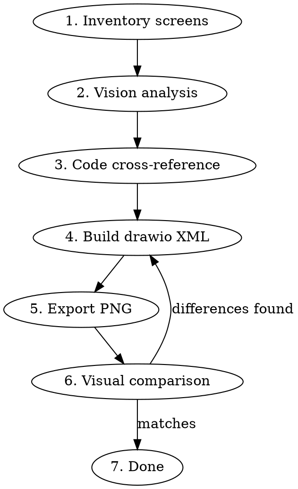

# Reverse Wireframe UI

Create structured draw.io wireframes from existing app screenshots by identifying UI elements, cross-referencing with source code (any framework), and producing annotated `.drawio` + `.png` deliverables.

Works with any UI framework: React Native, SwiftUI, Flutter, Vue, Angular, web apps, etc. The drawio output is framework-agnostic — only the code cross-reference phase is framework-specific.

## When to Use

- User provides screenshots/mockups and wants wireframe diagrams
- Documenting an existing app's UI structure for handoff or re-implementation
- Creating visual specs from a running app or design screenshots
- Need to map screenshot elements to actual component names in code
- Migrating between frameworks (e.g. React Native → SwiftUI) and need a visual spec as bridge

## Workflow



## Phase 0: Pre-flight Checks

Before processing screenshots, verify they fit within Claude's vision limits:

1. **Check dimensions**: Run `identify -format "%wx%h  %f\n" *.png` (ImageMagick) on all screenshots
2. **Resize if needed**: If any dimension exceeds **1568px**, resize: `mogrify -resize "1568x1568>" *.png`
   - Claude's recommended max is 1568px on the longest side
   - 2000px is the hard limit for multi-image requests
   - iPhone @3x screenshots (1170x2532) **always** need resizing
3. **Verify**: Re-check dimensions after resize to confirm all are within limits

Skip this phase only if you've confirmed all images are already ≤1568px.

## Phase 1: Inventory Screens

Glob the screenshot directory. Name each screen by its file name pattern:
- `Screen - Main.png` = main/default state
- `Screen - Main - Filter Active.png` = variant with a filter selected
- `Screen - Detail Popup.png` = popup/modal overlay

Group screens by base state vs. variants vs. overlays. Variants share most elements with the base — only document the delta.

## Phase 2: Vision Analysis

Read each screenshot with the `Read` tool (LLM vision). For each screen, identify **top-to-bottom**:

1. **Status bar** (OS chrome)
2. **Navigation bars** (utility bar, header)
3. **Scrollable content sections** (cards, lists, filters)
4. **Floating elements** (FABs, overlays)
5. **Tab bars** (bottom navigation)

For each element, note:
- **Visual role**: pill, card, badge, text label, icon button, separator
- **Content**: actual text/values shown
- **Color**: fill, border, text colors (use hex from the screenshot)
- **State**: active/inactive, selected/unselected, expanded/collapsed
- **Grouping**: which elements are visually contained in panels/cards

## Phase 3: Code Cross-Reference

**If no codebase is visible in the current working directory, ask the user:** "Is there source code available for this app? If so, where?" — the wireframe is much more useful when element names map to real component names.

If code is available, search for component names that map to visual elements. This phase is framework-agnostic — adapt the search strategy to the tech stack. If no code exists, use generic descriptive names (e.g. `category-filter-pills`, `provider-bar`, `stats-card`).

### Searching large files

App entry points can be enormous (2MB+). Never try to read the whole file — it will exceed token limits. Instead:

1. **Grep for imports first** — find component names used on the screen
2. **Grep for render functions / template sections** — search by visible text strings from the screenshot
3. **Read targeted offsets** — once you find the line number, read ±40 lines around it
4. **Read the imported component files** — they're usually small and self-contained

**React / React Native example:**
```bash
grep "import.*from" app/(tabs)/index.tsx | head -30
grep "ITEMS FOUND\|FEATURED\|renderHeader\|renderMainTabs" app/(tabs)/index.tsx
```

**Vue / Nuxt example:**
```bash
grep "<template>\|<script.*setup>\|defineComponent" pages/index.vue
grep "ITEMS FOUND\|FeaturedCard\|CategoryFilter" components/**/*.vue
```

**SwiftUI example:**
```bash
grep "struct.*View\|var body" Sources/Views/*.swift
grep "Text(\"ITEMS FOUND\")\|NavigationStack" Sources/Views/HomeView.swift
```

**Flutter example:**
```bash
grep "class.*Widget\|build(BuildContext" lib/screens/*.dart
grep "'ITEMS FOUND'\|FeaturedCard\|CategoryFilter" lib/screens/home_screen.dart
```

### Build a mapping table

| Visual Element | Component/Function | File |
|---|---|---|
| Category filter pills | `renderCategoryTabs()` / `CategoryFilterBar` | `app/(tabs)/index.tsx` |
| Provider chips | `<ProviderBar compact />` | `src/components/ProviderBar.tsx` |
| Metric card | `<MetricCard compact />` | `src/components/metrics/MetricCard.tsx` |
| Bottom tab bar | Tab layout config | `app/(tabs)/_layout.tsx` |

This mapping goes into the annotation panel of the wireframe.

**CRITICAL — This mapping also drives Phase 4 layer definitions.** Each component/function in the mapping table becomes a drawio layer. Do NOT proceed to Phase 4 without this table complete. When dispatching sub-agents for parallel wireframe generation, the mapping table must be completed first and included in each agent's prompt.

## Phase 4: Build Drawio XML

**REQUIRED SUB-SKILL:** Use `drawio-diagram` for XML conventions, style guide, and export workflow.

### mxGraphModel attributes

Always set `sketch="0"` to prevent hand-drawn/wavy edge rendering:

```xml
<mxfile host="Claude" agent="drawio-skill" version="1.0">
  <diagram name="Screen Name" id="screen-id">
    <mxGraphModel dx="0" dy="0" grid="1" gridSize="10" guides="1" tooltips="1"
      connect="1" arrows="1" fold="1" page="1" pageScale="1"
      pageWidth="400" pageHeight="1700" math="0" shadow="0" sketch="0">
```

Without `sketch="0"`, drawio may render all shapes with wobbly/hand-drawn edges — especially in newer versions. This makes wireframes look unprofessional.

### Page sizing

Set the page wide enough for the phone frame + legend side-by-side:
- Phone frame: 380px wide (x=10 to x=390)
- Legend: starts at x=410, ~380px wide
- **Page width: 820px** (fits both)
- **Page height**: match the phone frame height + 20px margin

**Phone frame height rule — no dead space:**
1. Find the lowest element's bottom edge: `max(y + height)` across all elements
2. Add 16px padding below
3. Set phone frame height = `bottom_edge + 16 - phone_y`
4. Set page height = phone frame height + 20

Never leave empty dark space below the last element — it looks broken. Recalculate frame height every time content changes.

Do NOT use a tall page (1700px) with legend below — place the legend to the **right** of the phone, like a sidebar.

### Element style patterns

Adapt colors to match the app's theme. Below is an example for **dark-themed mobile apps** (common in data-dense/fintech/pro tools). For light-themed apps, invert: use white/light fills and dark borders.

```xml
<!-- Phone frame container -->
style="rounded=1;whiteSpace=wrap;html=1;fillColor=#0A0E1A;strokeColor=#1E2D3D;strokeWidth=2;arcSize=8;"

<!-- Dark card -->
style="rounded=1;whiteSpace=wrap;html=1;fillColor=#0A0E1A;strokeColor=#1E2D3D;"

<!-- Active pill (teal) -->
style="rounded=1;whiteSpace=wrap;html=1;fillColor=#00D4AA20;strokeColor=#00D4AA;fontColor=#00D4AA;fontSize=11;fontStyle=1;"

<!-- Inactive pill -->
style="rounded=1;whiteSpace=wrap;html=1;fillColor=#0A0E1A;strokeColor=#1E2D3D;fontColor=#6B7280;fontSize=11;fontStyle=1;"

<!-- Tinted stat card (e.g. green tint) -->
style="rounded=1;whiteSpace=wrap;html=1;fillColor=#00D4AA10;strokeColor=#00D4AA30;"

<!-- Text label -->
style="text;html=1;align=left;verticalAlign=middle;resizable=0;points=[];strokeColor=none;fillColor=none;fontColor=#F0F0F5;fontSize=12;fontStyle=1;"

<!-- Left accent border on a card -->
style="rounded=0;whiteSpace=wrap;html=1;fillColor=#00D4AA;strokeColor=none;"
<!-- width=3, same height as card, same x/y position -->
```

### Layers for grouping (REQUIRED)

Use drawio **layers** to group elements by UI section. Layers are `mxCell` elements with `parent="0"` — each child element references its layer's id as `parent`.

```xml
<mxCell id="0" />
<mxCell id="1" value="Phone Frame" parent="0" />           <!-- Layer 1 -->
<mxCell id="layer-header" value="Header" parent="0" />     <!-- Layer 2 -->
<mxCell id="layer-content" value="Content" parent="0" />   <!-- Layer 3 -->
<mxCell id="layer-legend" value="Legend" parent="0" />      <!-- Layer 4 -->

<!-- Elements reference their layer -->
<mxCell id="phone" parent="1" ... />                        <!-- On Phone Frame layer -->
<mxCell id="header-title" parent="layer-header" ... />      <!-- On Header layer -->
<mxCell id="ann-title" parent="layer-legend" ... />         <!-- On Legend layer -->
```

**Layer naming rule — COMPONENT-LEVEL, not UI-zone:**

Layers MUST map 1:1 to actual code components/functions found in Phase 3, NOT to generic UI zones like "Content" or "Filters". The Phase 3 mapping table defines your layers.

**Fixed layers** (always present, render order = z-order):

| # | Layer ID | Contents |
|---|---|---|
| 1 | `1` (default) | Phone frame background |
| 2 | `layer-statusbar` | OS status bar text |
| N-2 | `layer-floating` | FABs, overlays |
| N-1 | `layer-tabbar` | Bottom tab bar |
| N | `layer-legend` | Documentation (toggleable) |

**Dynamic layers** (derived from Phase 3 code mapping — examples):

| Code Component | Layer ID | Layer Value |
|---|---|---|
| `MetricBox x4` | `layer-metrics` | "MetricBox x4 (key metrics)" |
| `Overview()` tab | `layer-overview` | "Overview() Tab Content" |
| `Analytics()` tab | `layer-analytics` | "Analytics() Tab Content" |
| `Rankings` section | `layer-rankings` | "Rankings (Top Metrics)" |
| `AlertList` section | `layer-alerts` | "Alert Cards" |

**NEVER use a generic `layer-content` catch-all.** If you find yourself putting all scrollable content in one layer, you skipped Phase 3 or didn't use its output. Go back and split by component.

**Why layers, not background rects:**
- Background rects (`rounded=0`) overlapping a rounded phone frame cause **corner artifacts** (sharp rect pokes out of rounded corners at top/bottom)
- Invisible rects (`fillColor=none;strokeColor=none`) add XML bloat with zero visual benefit
- Layers are toggleable in draw.io's Layers panel — you can hide the legend, isolate one section, etc.

**Rule: Never use invisible rectangles for grouping.** If you need to group elements visually, use a layer. If you need a visual background (like a card), keep the visible rect but parent it to the layer.

### Other structuring rules

1. **Use semantic IDs**: `section-header`, `category-filter`, `metric-card` — not `cell1`, `cell2`
2. **Comment blocks per layer**: `<!-- ======== LAYER: Header ======== -->`
3. **Cards contain their children visually**: place text cells inside the card's bounding box using absolute coordinates (drawio doesn't nest text inside rounded rects well, so overlap them)
4. **Pill rows**: place pills side-by-side with 6-8px gaps, matching the screenshot's horizontal scroll layout
5. **Variant screens**: copy the base wireframe, then modify only the changed sections (different active tab, different content area)
6. **Overlay/popup screens**: draw the dimmed background (fillColor with alpha like `#00000099`), then the modal sheet on top
7. **No overlapping rects at frame edges**: Don't place sharp rectangles at the top/bottom of the rounded phone frame — use separator lines (`height=1`) instead

### Legend (component hierarchy) — placement rules

Place legend text to the **right** of the phone frame (x=410+), directly on the page background. No background panel needed — the page canvas is already white/light.

```xml
<!-- Title — right of phone -->
<mxCell id="ann-title" value="Screen Name [Wireframe]" style="text;html=1;align=left;verticalAlign=top;resizable=0;points=[];strokeColor=none;fillColor=none;fontColor=#222222;fontSize=14;fontStyle=1;" vertex="1" parent="1">
  <mxGeometry x="410" y="16" width="366" height="24" as="geometry" />
</mxCell>
<!-- Component tree (monospace) -->
<mxCell id="ann-desc" value="Component Hierarchy:&#xa;├─ ..." style="text;html=1;align=left;verticalAlign=top;resizable=0;points=[];strokeColor=none;fillColor=none;fontColor=#333333;fontSize=9;fontFamily=Courier New;" vertex="1" parent="1">
  <mxGeometry x="410" y="50" width="366" height="820" as="geometry" />
</mxCell>
```

**Key rules:**
- **Never** place legend text inside or below the dark phone frame — it becomes unreadable
- **Never** add a white background panel if the text is already on the page canvas
- Legend goes to the right, aligned to the top of the phone frame

The legend should include:
- Screen name and variant description
- Component hierarchy tree (using `├─ └─ │` box-drawing chars)
- Component name → code function/file mapping
- For variants: list only what differs from the base screen

## Parallel Agent Dispatch (for bulk processing)

When processing 5+ screenshots, dispatch parallel agents for efficiency. **Sequencing is critical:**

1. **Phase 0-3 must complete BEFORE dispatching agents** — the code mapping table, color tokens, and layer definitions are shared context that every agent needs
2. **Include in each agent's prompt:**
   - The complete Phase 3 mapping table (component → file → line)
   - The layer definitions derived from the mapping
   - Color token reference (bg, card, border, primary, text colors)
   - Style patterns (card style, pill style, text style strings)
3. **Batch by screen group** — agents working on the same screen family (e.g., all Player Props parts) share structure and can reuse layer definitions
4. **Never let agents invent their own layer names** — they must use the layers from the shared mapping

## Phase 5: Export & Visual Comparison

Export via temp path (spaces in filenames cause issues with drawio CLI):

```bash
cp "Screen [Wireframe].drawio" /tmp/wireframe.drawio
drawio --no-sandbox -x -f png --scale 3 -o /tmp/wireframe.png /tmp/wireframe.drawio
cp /tmp/wireframe.png "Screen [Wireframe].png"
```

- `--no-sandbox` required in containers
- `--scale 3` optimal for LLM vision review (~5000px, higher wastes tokens)
- dbus warnings in stderr are harmless — check for `->` in output to confirm success

Then read both the exported PNG and the original screenshot with the `Read` tool. Compare:
- Element order top-to-bottom
- Relative sizing and spacing
- Active/inactive states
- Text content accuracy
- Missing or extra elements

Fix differences in the drawio XML, re-export, re-compare until matched.

## Deliverables Per Screen

| File | Purpose |
|---|---|
| `Screen Name [Wireframe].drawio` | Editable source with grouped elements + annotations |
| `Screen Name [Wireframe].png` | Visual reference (3x scale, includes annotation panel) |

## Common Mistakes

| Mistake | Fix |
|---|---|
| Annotation text on dark bg — unreadable | White panel (`fillColor=#FFFFFF`) with dark text (`fontColor=#333333`) |
| Missing `sketch="0"` on mxGraphModel | Edges render wavy/hand-drawn. Always add `sketch="0"` to the `<mxGraphModel>` tag |
| Invisible rects for grouping | Use layers (`parent="0"`) — invisible rects add bloat and cause corner artifacts |
| Sharp rects at frame edges | Use 1px separator lines instead — sharp rects overlap rounded phone frame corners |
| Generic cell IDs (`id="2"`) | Semantic IDs (`id="category-filter"`, `id="metric-card"`) |
| Skipping code cross-reference | Element names won't match codebase — always check imports/render functions |
| Trying to read huge entry files whole | Files >256KB fail. Use grep to find line numbers, then Read with offset/limit |
| One wireframe for variant screens | Create separate drawio per screen state — variants share structure but differ in active states/content |
| Spaces in drawio CLI paths | Copy to `/tmp/` before export, copy PNG back after |
| `--scale 4+` for export | Wastes tokens — Claude downsamples to ~1568px internally, `--scale 3` is the sweet spot |
| Placeholder text instead of screenshot values | Match exact text from screenshots (badge counts, prices, names) — not generic placeholders |
| Alpha transparency not working | Drawio supports 8-digit hex `#RRGGBBAA` — e.g. `#00000099` for 60% black overlay, `#00D4AA10` for 6% teal tint |
| Generic `layer-content` catch-all | **Fatal flaw.** Split into component-level layers from Phase 3 mapping. Each code function = one layer. |
| Legend uses HTML `<pre>` or complex HTML | Use plain `text` style with `&#xa;` for line breaks and `fontFamily=Courier New`. HTML blocks clip in PNG export. |
| Phase 3 mapping not used for layers | The mapping table must drive layer definitions in Phase 4. If layers don't match component names, Phase 3 was wasted. |
| Screenshots exceed Claude vision limits | Run Phase 0 pre-flight. iPhone @3x (1170x2532) always needs `mogrify -resize "1568x1568>"` before processing. |
| Sub-agents get generic layer instructions | Complete Phase 3 code cross-reference BEFORE dispatching agents. Include the mapping table in each agent's prompt. |
