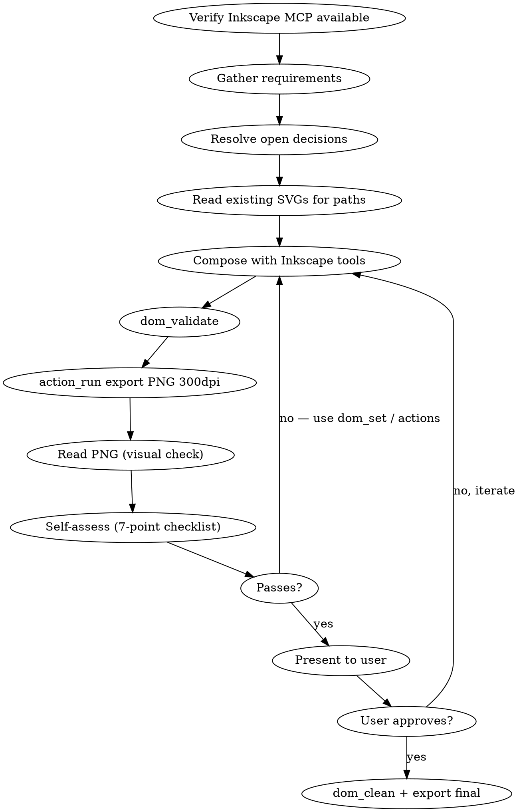

# Vector Designer

## HARD DEPENDENCY: Inkscape MCP Required

This skill REQUIRES the Inkscape MCP server (`mcp__inkscape-mcp__*` tools). Before any work:

1. Verify `mcp__inkscape-mcp__dom_validate` is callable
2. If Inkscape MCP tools are NOT available → **STOP. Tell the user: "Inkscape MCP is required for vector design. Please configure the inkscape-mcp server."** Do NOT fall back to Bash CLI, do NOT hand-craft SVG geometry.

**There is no fallback. No Inkscape MCP = no vector design work.**

## FORBIDDEN — Anti-Patterns That Produce Bad Results

These patterns are STRICTLY PROHIBITED. They produce amateur output:

| FORBIDDEN | Why | Do Instead |
|-----------|-----|------------|
| Hand-drawing `<polygon points="...">` to approximate letterforms | Produces crude geometric shapes, not typography | Use existing font paths from client SVGs or Inkscape text-to-path |
| Guessing coordinates for `<rect>`, `<polygon>`, `<path>` to create letters | Looks like a child's drawing compared to real typefaces | Extract paths from existing professional SVGs |
| Using Bash `inkscape` CLI as fallback | Bypasses the MCP design loop; no validation/iteration | Use MCP `action_run` exclusively |
| Creating "geometric K" or "simplified R" from basic shapes | Always looks worse than the real typeface | Scale/transform existing professional paths with `matrix()` transforms |
| Writing SVG path `d=""` data by hand for anything complex | Error-prone, ugly results | Use Inkscape path operations: `path-union`, `path-difference`, `path-combine` |
| Presenting v1 to user without self-assessment | Wastes user's time on rough drafts | Self-assess 3-5 iterations internally first |

### The Cardinal Rule

**If the client has existing SVG assets with professional letterforms — USE THEM.** Extract the paths, apply transforms (`matrix()`, `translate()`, `scale()`), use Inkscape operations to modify. NEVER recreate what already exists as high-quality vector data.

## Overview

Design vector graphics iteratively using Inkscape MCP for ALL validation, export, path operations, and SVG manipulation. The core loop: **source professional paths -> compose with Inkscape tools -> validate -> export PNG -> view -> self-assess -> iterate**.

## When to Use

- Creating logos, icons, favicons, badges
- Designing SVG assets for web/print
- Creating wallpapers, backgrounds, and landscape compositions
- Any task requiring visual iteration on vector graphics
- Converting/cleaning existing SVGs
- **Vectorizing a raster image (JPG/PNG → SVG)** — see [references/vectorize.md](references/vectorize.md)

## When NOT to use

- Raster image editing (photos, pixel art, image filters)
- UI component implementation in code (React, SwiftUI)
- CSS-only designs that don't involve SVG files
- Architecture or flow diagrams (use drawio-diagram)

## Core Loop



**Critical: do NOT present v1 to user.** Self-assess internally for 3-5 iterations first.

## Inkscape MCP Tools

| Tool | Purpose | Key params |
|------|---------|------------|
| `dom_validate` | Check SVG structure | `doc_type: "inline"`, `doc_svg: "<svg>..."` |
| `action_run` | Export to PNG/PDF/SVG | `export_type`, `export_dpi`, `export_out` (relative only) |
| `dom_set` | Modify element attrs/styles | `ops_json`, `save_as` (relative only) |
| `dom_clean` | Optimize SVG with scour | `save_as` (relative only) |
| `action_list` | List available Inkscape actions | (no params) |

### Input Modes

- **`doc_type: "inline"`** + `doc_svg: "<svg>..."` — pass SVG as string. Best for iterating.
- **`doc_type: "file"`** + `doc_path: "relative/path.svg"` — read from file. Best for existing SVGs.

### action_run: Path Operations

- `path-union`, `path-difference`, `path-intersection`, `path-exclusion`, `path-combine`, `path-break-apart`, `path-simplify`
- Selection: `select-by-id:myElement`, `select-all`, `select-clear`
- Transform: `object-to-path`, `transform-scale:1.5`, `transform-rotate:45`, `object-align:hcenter vcenter page`

### dom_set: Batch Attribute Changes

```json
[
  {"sel": "#shield", "set": {"fill": "#C8FF00", "stroke-width": "2"}},
  {"sel": ".accent", "style": {"opacity": "0.8"}}
]
```

### Bounding Boxes — Precise Measurements

Query element widths directly (don't measure from PNG crops):

```bash
inkscape file.svg --query-id=elementId -W       # width
inkscape file.svg --query-id=elementId -X -Y -W -H   # full bbox
```

This is the one permitted Bash `inkscape` usage — read-only query, not design work.

### Workspace & Limitations

- MCP outputs to `inkscape/` relative to project root. **Absolute paths fail.** Copy to final destination with Bash.
- Inline export **fails silently for large SVGs**. Workaround: write SVG to file, use `doc_type: "file"`, or split into parts. **No CLI fallback.**

## Design Process

### 1. Requirements Gathering

Extract: target sizes, color system, stroke weight, variants needed (light/dark, filled/stroke), reference material.

### 2. Resolve Decisions First

Use `AskUserQuestion` for: favicon strategy, dark mode treatment, color unification, proportions.

### 3. Concept Selection

| Strategy | When to use | Example |
|----------|-------------|---------|
| **Single shape + inner symbol** | One core concept + domain | Shield with `>_` |
| **Two nested shapes** | Two equal concepts | Box containing shield |
| **Composition inversion** | Nesting creates wrong metaphors | Make outer = concept A, inner = B |
| **Silhouette only** | Iconic shape | Docker whale |

**When two shapes fight, eliminate one.**

### 4. Source Professional Paths & Compose

**NEVER hand-draw letterforms.** Priority: client SVGs → Inkscape text-to-path → path operations → geometric primitives (containers only).

**Logo SVG principles:**
- ViewBox: integer coords, square for icons
- Element count: 2-4 max
- Weight hierarchy: boundary (2.5px) > inner (2px) > details (1.5px)
- Hero sizing: 60-70% of composition
- Content fills 80-90% of viewBox area

### 5. Validate -> Export -> View -> Self-Assess

```
1. dom_validate → 2. Write SVG to file → 3. action_run export PNG 300dpi
4. Read PNG → 5. Run Self-Assessment Checklist
```

**Always save BOTH SVG and PNG with identical names** for every iteration.

### 6. Finalize

`dom_clean` → copy to final paths. For dark mode, write SVG with CSS `@media (prefers-color-scheme: dark)` using `Write` tool (Inkscape strips media queries).

## Inkscape Layers

When an SVG has multiple logical blocks (states, variants), organize into layers:

```xml
<g inkscape:groupmode="layer" inkscape:label="Normal (240px)" id="layer-normal" style="display:inline">
```

One layer per state/variant + shared background layer. Requires `xmlns:inkscape` namespace.

## Self-Assessment Checklist

Run after EVERY iteration before presenting to user:

1. **Identity**: Does it read as the intended concept at a glance?
2. **Hero dominance**: Primary shape fills 60-70%?
3. **Distinctiveness**: Name 3 logos it could be confused with. If you can — redesign.
4. **Scale survival**: Will key shapes survive at 16px? 32px?
5. **Weight hierarchy**: At least 2 different stroke weights?
6. **Dark mode**: Accent maintains contrast on `#111`?
7. **Stroke vs fill**: Both variants work as standalone marks?

**If any answer is "no" — iterate before presenting.**

## Logo Design Principles

**Metaphor traps:** Rectangle + line = browser. Rounded rect + dots = app icon. Briefcase handle = travel.

**Composition:** Composition inversion is the most powerful technique. Fewer shapes = stronger mark. Inner symbol gives identity.

**Visual weight:** 2-3 stroke weights for depth. Accent fill creates brand recognition. Design dark-first.

**Iteration:** v1 (rough) → v2 (proportions) → v3 (metaphor fix) → v4-v5 (refine). The v3 restructure is where the biggest leap happens.

**Color roles:** 1) Accent (1 only, vivid) → 2) Structural (#111/#fff) → 3) Detail (subtle gray, iterate 2-3 hex steps).

**Centering:** Verify mathematically against viewBox, not visually. **Scale:** if invisible at 16px, enlarge or remove.

## Logo Animation (CSS)

Animation lives in **CSS on HTML wrappers**, NOT inside SVG. The SVG stays rigid (`flex-shrink: 0`). See [references/animation-guide.md](references/animation-guide.md) for the full brand reveal pattern, HTML structure, CSS keyframes, timing sequence, dark mode delivery methods, and test page setup.

## Wallpaper & Landscape Design

Wallpapers invert logo rules: gradients essential, 10-15 layered paths, full spectrum color, fill-first, organic curves. See [references/wallpaper-design.md](references/wallpaper-design.md) for wave anatomy, color progression strategy, saturated color handling, logo visibility on dark backgrounds, and the wallpaper self-assessment checklist.

## Design Philosophy

Follows **Dieter Rams** (what to remove) + **Swiss International Typographic Style** (how to align what's left). See [references/design-philosophy.md](references/design-philosophy.md) for Rams' principles mapping, logo messaging, the dev tool aesthetic, elegance through restraint, and reference logos.

## Common Mistakes

| Mistake | Fix |
|---------|-----|
| Hand-drawing polygon/path for letters | Use existing professional paths from client SVGs |
| Using Bash `inkscape` CLI | Use Inkscape MCP tools exclusively |
| Absolute export paths | Relative only; copy from `inkscape/` after |
| Skipping `dom_validate` | Always validate before export |
| Not viewing PNG after export | Always `Read` the PNG |
| Saving PNG without matching SVG | Always save both with identical names |
| Presenting v1 to user | Self-assess 3-5 iterations internally first |
| Hero element too small | Must fill 60-70% of composition |
| Uniform stroke weight | Use 2-3 weights for hierarchy |
| `` tag for dark-mode SVG | Inline the SVG |
| Animation inside SVG file | CSS animations go on HTML wrappers |
| Centering by eye | Verify mathematically against viewBox |
| MCP inline export for large SVGs | Write to file, use `doc_type: "file"` |

## Questions to Ask Before Starting

1. **"Is there an existing icon, wallpaper, or visual reference I should match?"**
2. **"What should this NOT look like?"**
3. **"What's the single most important word this logo should communicate?"**

## References

| File | Contents |
|------|----------|
| [references/design-philosophy.md](references/design-philosophy.md) | Rams + Swiss Style, logo messaging, dev tool aesthetic, elegance |
| [references/animation-guide.md](references/animation-guide.md) | CSS brand reveal pattern, HTML/CSS templates, timing, dark mode delivery |
| [references/wallpaper-design.md](references/wallpaper-design.md) | Wave wallpapers, color progression, saturated colors, landscape iteration |
| [references/wordmark-alignment.md](references/wordmark-alignment.md) | Optical centering, font selection, viewBox trimming, text-to-path |
| [references/vectorize.md](references/vectorize.md) | Bitmap → SVG pipeline, potrace, render→view→compare QA loop |
