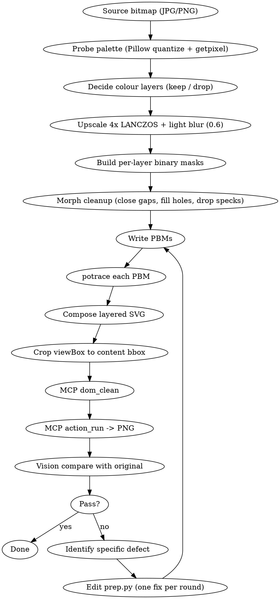

# Subskill: Bitmap → Vector

Convert a raster image (JPG/PNG) to a clean SVG with controlled colour layers. Use when the user wants a logo, icon, or illustration extracted from a bitmap — typically from a sketch, scan, photo, or low-res asset that needs to live as a scalable vector.

The headline rule: **vectorization is a QA loop, not a one-shot.** Render the result back to PNG, compare to the source with vision, and iterate. Each pass tightens one specific defect — don't try to fix everything in one prep script.

## When this subskill applies

- "Vectorize this image" / "trace this" / "convert to SVG"
- "Remove the background and keep just the [subject]"
- "Make a logo out of this photo / sketch"
- "Get me an SVG of [thing] from this JPG"

If the user just wants a *picture* (still a raster) without scalability, this is not the right subskill — point them to ImageMagick or a designer.

## Tool reality

The Inkscape MCP `object-trace` action requires the GUI dialog and is not headless-driveable. Multi-colour trace via the MCP is **not feasible**. Use the underlying tracer (`potrace`) directly via Bash. This is explicitly allowed for vectorization work — the MCP rule against Bash inkscape applies to *design* operations (path ops, exports, validation), not to bitmap-trace pre-processing.

What stays on MCP:
- `dom_clean` (scour optimisation) on the final SVG
- `action_run` for the canonical PNG export of every iteration (this is how you "view" your work — never fall back to Bash inkscape for it)

What goes to Bash / Python:
- `potrace` for the binary→SVG conversion itself (install: `nix profile install nixpkgs#potrace`)
- Python + Pillow + numpy for pixel-level pre-processing (colour masking, morphology, hole-fill, component filtering)

## Pipeline



## QA loop — the heart of the subskill

Vectorization quality is invisible without rendering the SVG back to a raster and comparing it to the original side-by-side. Every iteration:

1. **Render** the current SVG to PNG via MCP `action_run` (or for comparable size, pass `export_width=<original_width × N>`).
2. **Read** both the source bitmap and the rendered PNG with the `Read` tool — both arrive as images and you see them as a multimodal model.
3. **Verbalise the differences.** Write them down before touching code. Examples of useful diff vocabulary:
   - "Outline is too thick / too thin / uneven"
   - "Eye dots missing / merged / bloated"
   - "Whisker tips extend beyond the body silhouette"
   - "Background colour leaked into the silhouette on the right side"
   - "Corners are wobbly where the source has crisp angles"
   - "Tiny stray specks in the corners (JPG noise traced as paths)"
4. **Map each defect to its root cause.** A defect class points to a specific knob:
   - Bloated edges → blur radius too high, or threshold too loose, or upscale × LANCZOS ramp
   - Lost fine detail (eye dots, whisker tips) → blur too high, or erosion step too aggressive
   - Stray specks → no `min_pixels` component filter; bump `--turdsize`
   - Wobbly corners → `--alphamax` too low; raise to 1.2–1.4
   - Path bloat → `--opttolerance` too tight; raise to 0.4–0.6
   - Background leaks into silhouette → red/green mask too narrow; widen colour predicate or dilate the maroon/green mask
5. **Edit `prep.py` for one defect at a time.** Multiple simultaneous changes make it impossible to tell which one regressed. Keep `prep.py` deterministic — same inputs → same masks.
6. **Re-trace, re-render, re-compare.** Stop when the next defect is below the "ship vs. polish" line for the asset's display size.

**Cardinal rule: don't trust file size or path count.** The only signal that matters is *does the rendered PNG look like the source*. A small SVG can be wrong; a large one can be right.

## Pre-processing recipes

### Probe the palette first
Before writing any masking code, find out what colours you're dealing with:

```python
from PIL import Image
from collections import Counter
im = Image.open(SRC).convert('RGB')
p = im.quantize(colors=8).convert('RGB')
for col, n in Counter(p.get_flattened_data()).most_common():
    print(f"#{col[0]:02x}{col[1]:02x}{col[2]:02x}  {col}  {n}")
# Also probe known regions:
for label, (x, y) in [('bg', (5, 5)), ('subject', (W//2, H//2))]:
    print(label, im.getpixel((x, y)))
```

This tells you the actual hex values and rough proportions — and prevents you from writing colour predicates from imagination.

### Upscale strategy
- **4×** is the sweet spot for small sources (under 200 px). Higher (8×) bloats LANCZOS ramps and bleeds edges into surrounding pixels.
- **LANCZOS** is the right resample, not NEAREST. Anti-aliased ramps give potrace clean signal to smooth.
- **Post-upscale blur of 0.6 radius** kills LANCZOS ringing without erasing fine features (eye dots ~1-2 px in the source survive).
- **Don't pre-blur the source** if the source has thin lines (eye dots, whiskers). Pre-blur shrinks dark regions before threshold and you lose them entirely.

### Colour predicates
Don't use absolute thresholds. Use **channel ratios** so the predicate survives JPG quality variation:

```python
is_maroon = (R - G > 20) & (R - B > 10) & (R > 70) & (R < 230)
is_green  = (G - R >= 5) & (G > 70) & (R < 200)
is_dark   = (Y < 95)        # only for foreground ink; combine with NOT halo
is_tan    = (R > 180) & (G > 150) & (R > B + 20)
```

The `R - G > 20` form survives a wider range of saturation/exposure than `R > 130`.

### Halo guard
After painting unwanted colours (maroon, green) to white, dark JPG halo pixels at the *boundary* of those regions will still trigger `is_dark` and contaminate the outline mask. Defend with a dilation buffer:

```python
near_red_green = dilate(is_maroon | is_green, k=4)
is_dark_clean = is_dark & ~near_red_green
```

`k=4` at 4× upscale removes ~1 px of source halo. Bump `k` if dark fragments appear *inside* what should be the cleaned background.

### Silhouette construction
"Foreground subject as one solid blob" is its own mask, separate from the ink mask:

```python
blob = is_dark_clean | is_tan
blob = closing(blob, k=5)        # bridge thin ink gaps
silhouette = largest_component(blob)
silhouette = closing(silhouette, k=6)   # smooth jagged edges
silhouette = fill_holes(silhouette)     # flood-fill background from edges, invert
silhouette = opening(silhouette, k=2)   # drop tiny outer spurs
silhouette = closing(silhouette, k=3)   # re-fill any nicks the opening introduced
```

`fill_holes` is what turns a "subject with speckle holes" into a "subject as a clean shape". Implement as BFS from the image edges marking reachable background; the complement is the filled silhouette.

### Outline mask
Restrict ink to inside the silhouette + a small halo, and drop tiny stray components:

```python
outline = is_dark_clean & dilate(silhouette, k=3)
outline = keep_components(outline, min_pixels=40)
```

The component filter is what kills "stray whisker spike" artifacts that survived everything else.

### Don't erode the ink
Tempting to thin the outline with `erode(outline, k=1)` to undo LANCZOS bloat. **It erases small features.** Eye dots, whisker tips, nostril dots are 2-4 px even at 4× scale and 1-px erosion deletes them entirely. Solve outline thickness with `--turdsize` and `--alphamax` in potrace instead.

## potrace settings

`potrace 1.16` smoothing knobs that matter:

| Flag | Range | What it controls |
|------|-------|------------------|
| `--turdsize N` | 40 – 300 | Drops paths smaller than N units. Higher → fewer specks, but eye dots disappear above ~120. |
| `--alphamax N.N` | 0.5 – 1.34 | Corner threshold. Higher → smoother curves, fewer hard corners. 1.3 is a good default for organic shapes. 1.0 keeps more crisp corners. |
| `--opttolerance N.N` | 0.2 – 1.0 | Curve-fit tolerance. Higher → simpler paths (smaller file). 0.4–0.5 is the visual-quality sweet spot. |

Two passes is normal: silhouette mask gets a higher `--turdsize` (200+) because you want one big blob; ink gets a lower one (40–80) so eye dots survive.

```bash
potrace silhouette.pbm -s -o silhouette.svg --turdsize 200 --opttolerance 0.5 --alphamax 1.3
potrace outline.pbm    -s -o outline.svg    --turdsize 60  --opttolerance 0.5 --alphamax 1.3
```

`-s` is SVG output. Default is EPS — you do not want EPS.

## Composing the layered SVG

potrace emits an SVG with a `translate(0, H) scale(0.1, -0.1)` group transform (path coords in tenths, Y-flipped). The composition step keeps that transform and nests two coloured `<g>` blocks inside it:

```xml
<svg viewBox="0 0 W H" xmlns="http://www.w3.org/2000/svg">
  <g transform="translate(0, H) scale(0.1, -0.1)" stroke="none">
    <g id="subject-body" fill="#TAN">
      <path d="..."/>   <!-- from silhouette.svg -->
    </g>
    <g id="subject-ink" fill="#INK">
      <path d="..."/>   <!-- from outline.svg -->
      <path d="..."/>
      ...
    </g>
  </g>
</svg>
```

Order matters: body first (bottom), ink second (on top). Skip per-path `fill=` attributes — the parent `<g fill=>` covers them.

## Cropping viewBox to content

After composition, the viewBox usually has dead space (e.g. where the dropped green leaf was). Query each layer's bbox with the *allowed* Bash inkscape form:

```bash
inkscape kittou-logo.svg --query-id=subject-body -X -Y -W -H
inkscape kittou-logo.svg --query-id=subject-ink  -X -Y -W -H
```

Union them, add ~12–20 units of margin, set the new viewBox:

```python
viewBox = f"{nx} {ny} {nw} {nh}"
```

This is the one Bash inkscape usage explicitly allowed by the parent skill — it's a read-only query, not design work.

## Final cleanup via MCP

The Inkscape MCP server has its own workspace root (the directory it treats as `.` for `doc_type: "file"`), which is often **not** your project's working directory. Files referenced by `doc_type: "file"` must live inside that workspace root. Copy in, run, copy out:

```bash
cp <project>/inkspace/logo.svg <mcp-workspace-root>/
```

```jsonc
// mcp__inkscape-mcp__dom_clean
{
  "doc_type": "file",
  "doc_path": "logo.svg",
  "save_as": "logo-clean.svg"
}
```

```jsonc
// mcp__inkscape-mcp__action_run — canonical 300-DPI preview
{
  "doc_type": "file",
  "doc_path": "kittou-logo-clean.svg",
  "export_type": "png",
  "export_dpi": 300,
  "export_out": "kittou-logo-preview.png"
}
```

`dom_clean` typically saves 15–20 % via scour. Confirm the cleaned version still renders by re-running `action_run` and Read-ing the PNG.

## Browser sanity check

If the SVG will be served to a real browser (header logo, hero asset), **also render it through Chromium** via Playwright before declaring victory. Reasons to do this even after MCP `action_run` looks good:

- Scour's path compression can produce path syntax that Inkscape parses but a browser glitches on (rare, but happens).
- HTTP caching of an earlier (broken) SVG version masks new fixes — always cache-bust with `?v=<timestamp>` on the test request.
- `` natural dimensions are aspect-ratio-of-viewBox times a 150-px default. Verify the rendered `getBoundingClientRect()` is what you expect.

A quick `mcp__playwright__browser_evaluate` that inlines the SVG via `fetch + innerHTML` and prints `getBBox()` on each layer tells you instantly whether the browser is rendering both colour groups.

## Iteration discipline — lessons from practice

- **Save every iteration's PNG.** `v1.png`, `v2.png`, `v3.png`. When the user says "v2 was better, go back" you have it.
- **Keep `prep.py` reproducible.** Same source → same masks every run. Don't introduce randomness or path-globbing surprises.
- **One knob per round.** Changing both `--alphamax` and the blur radius in the same round destroys signal about which change helped.
- **Stop the loop when the next defect costs more iterations than it's worth at the display size.** A 40-px header logo doesn't need pixel-perfect ear notches.
- **The original drawing is the spec, not a generic "clean SVG".** If the source has a tail spike, the vector should have a tail spike — that's not an artifact, that's the artist's choice. Verify against the source before "cleaning" it away.

## Anti-patterns

| Don't | Why | Do instead |
|-------|-----|------------|
| Hand-write SVG path `d=""` data to approximate the subject | Always looks worse than `potrace` output, and isn't actually faster | Trace via `potrace`, then compose |
| Trust file size as a quality signal | Smaller can be wrong, bigger can be right | Render to PNG, vision-compare |
| Erode the outline mask to "thin the lines" | Erases eye dots, whisker tips, fine features | Tune `--turdsize` + `--alphamax` instead |
| Apply multiple fixes per iteration | Can't tell which one helped or regressed | One knob per round |
| Skip the browser test for web assets | Inkscape-render-OK doesn't guarantee Chromium-render-OK | Inline-fetch in Playwright, verify both `<g>` layers render |
| Treat scour as required | Sometimes scour's path minification triggers browser glitches | Keep the pre-scour SVG as a fallback |
| Aggressive `keep_largest_component` before close | Drops the cat's whisker tips before they re-connect | Close first, then largest-component |
| Trace the raw JPG without colour masking | Background and subject end up in the same layer | Always pre-mask unwanted colours to white |
