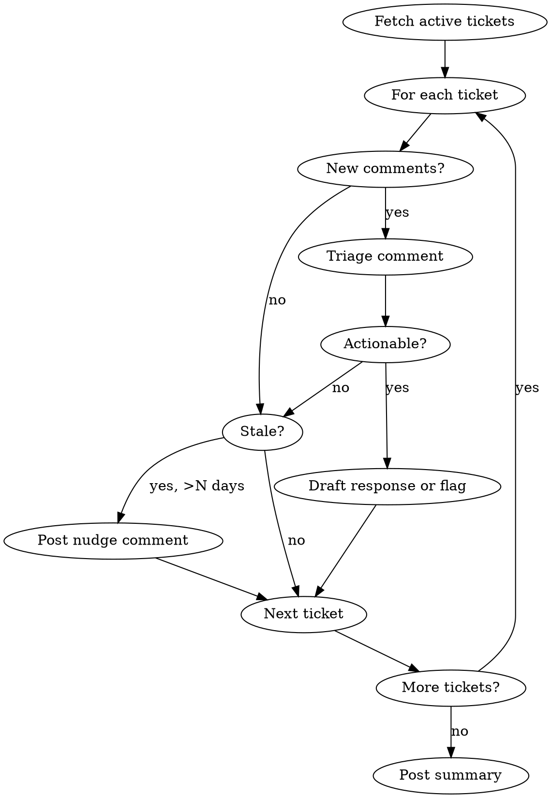

# Linear Worker

Autonomous monitor for Linear tickets. Polls assigned tickets, reacts to new comments, flags blockers, nudges stale work, and posts summaries.

## When NOT to use

- One-time ticket creation, updates, or grooming (use pm skill)
- Backlog analysis or ticket splitting (use pm skill)
- GitHub Issues or Jira workflows (Linear only)
- Ad-hoc ticket queries without ongoing monitoring

## Overview

Runs as a recurring routine (cloud) or `/loop` (local session). Each run:
1. Fetches tickets assigned to the target user in active states
2. Detects new comments since last activity
3. Takes configured actions (respond, flag, nudge, summarize)
4. Optionally posts a digest to Slack

## Setup (MUST run before core loop)

Your FIRST action must be to resolve scope. Do NOT scan all teams.

### Step 1: Identify the target user

```
mcp__linear__get_user({ query: "me" })
```

Save the `id`, `name`, `email`, and `teams` list.

### Step 2: Resolve team/project scope

Follow this cascade. Stop at the first match:

**A. Check CLAUDE.md / AGENTS.md for explicit config**

Read `CLAUDE.md` and `AGENTS.md` in the project root. Look for any of these patterns (case-insensitive):
- `linear-team: TEAM_KEY` or `linear team: TEAM_KEY`
- `linear-project: PROJECT_NAME` or `linear project: PROJECT_NAME`
- A line containing `linear.app/WORKSPACE/team/TEAM_KEY`

If found, use that team/project directly. Skip to step 3.

**B. Fuzzy-match repo name against Linear projects**

If no explicit config, get the repo name:
```
git remote get-url origin   # extract repo name from URL
```

Then search Linear projects for a fuzzy match:
```
mcp__linear__list_projects({ member: "me", limit: 50 })
```

Compare the repo name (lowercased, hyphens normalized) against project names. If a single strong match is found (e.g., repo `skills` matches project "Claude Skills"), propose it to the user for confirmation.

**C. Ask the user**

If no config and no fuzzy match (or multiple candidates), present the user's teams AND projects via AskUserQuestion:
- Group projects under their teams
- Default to the most recently updated team
- Allow "all" only if the user explicitly asks for it

If invoked via `/loop` or a cloud routine with a team already specified in the prompt, skip A/B/C and use the specified team.

### Step 3: Discover team statuses

```
mcp__linear__list_issue_statuses({ team: "CHOSEN_TEAM" })
```

Map status names to types (`unstarted`, `started`, `completed`, `canceled`). Active states are typically `started` type. Show the user which statuses will be scanned and confirm.

## Core Loop



### Step 1: Fetch active tickets (scoped to chosen team)

```
mcp__linear__list_issues({
  assignee: "me",
  team: "CHOSEN_TEAM",     // from setup step 2
  state: "In Progress",    // adapt to your team's status names
  limit: 50,
  orderBy: "updatedAt"
})
```

Repeat for each active status discovered in setup step 3 (e.g., `In Review`, `Todo`).

### Step 2: Check each ticket for new comments

```
mcp__linear__list_comments({ issueId: "ISSUE_ID" })
```

Look for comments not authored by the target user. Recency heuristic: compare `updatedAt` on the issue against last run time (pass via routine prompt or use a convention like "comments in the last 2 hours").

### Step 3: Triage and act

| Signal | Action |
|--------|--------|
| Comment asks a question | Draft a response comment (or flag for human review) |
| Comment reports a blocker | Add "blocked" label, comment acknowledging |
| Ticket in active state with no update > N days | Post nudge: "This ticket hasn't been updated in N days. Still in progress?" |
| Ticket marked "In Review" with no reviewer comment | Flag: "Awaiting review, no reviewer activity" |
| Comment is FYI / no action needed | Skip |

### Step 4: Post summary

Compile a digest of actions taken and tickets reviewed. Format:

```
Linear Worker Summary (YYYY-MM-DD HH:MM UTC)
━━━━━━━━━━━━━━━━━━━━━━━━━━━━━━━━━━━━━━━━━━━
Tickets scanned: N
  - Comments responded to: X
  - Blockers flagged: Y
  - Stale tickets nudged: Z
  - No action needed: W

Details:
  - ENG-123: responded to comment from @alice re: API timeout
  - ENG-456: flagged as blocked (missing design spec)
  - ENG-789: nudged (no update in 5 days)
```

Post to Slack if connector is available, otherwise just output.

## Deployment Modes

### Cloud Routine (recommended)

Set up via `/schedule`. Requires:
- Linear MCP connector at https://claude.ai/customize/connectors
- Slack MCP connector (optional, for digest)

Example routine prompt:
```
You are a Linear worker monitoring tickets for [USER_EMAIL].

Team: [TEAM_NAME]
Active states: In Progress, In Review, Todo
Stale threshold: 2 days

For each active ticket:
1. Check for new comments (last 2 hours)
2. If a comment asks a question, draft a helpful response
3. If a comment reports a blocker, add "blocked" label
4. If no updates in 2+ days, post a nudge comment
5. Skip FYI-only comments

After processing all tickets, post a summary to Slack channel #[CHANNEL].

Use mcp__linear__ tools for all Linear operations.
Use mcp__claude_ai_Slack__slack_send_message for Slack.
```

Schedule: `0 */2 * * 1-5` (every 2 hours, weekdays)

### Local loop

```
/loop 30m linear-worker
```

Runs in your active session. Useful for shorter monitoring windows.

## Configuration Points

| Parameter | Default | Description |
|-----------|---------|-------------|
| Target user | `"me"` | Linear user to monitor |
| Active states | `In Progress, In Review` | Which statuses to scan |
| Stale threshold | 2 days | Days without update before nudging |
| Comment window | 2 hours | How far back to check for new comments |
| Slack channel | none | Where to post digest (optional) |
| Auto-respond | false | Whether to post responses or just flag |

## Safety Rules

- **NEVER close or complete tickets automatically.** Only human users close tickets.
- **NEVER reassign tickets.** Flag reassignment needs in the summary.
- **NEVER delete comments or tickets.**
- Label additions (like "blocked") are safe to apply automatically.
- When `auto-respond` is false, add a comment prefixed with `[Linear Worker — draft response]` so the human can review before posting as their own.

## Linear Tool Reference

This skill uses the same Linear MCP bindings as the `/pm` skill. See the pm skill's `tools/linear.md` for the full operation mapping.

Key tools:
- `mcp__linear__list_issues` — fetch tickets by assignee/state/team
- `mcp__linear__get_issue` — get ticket details
- `mcp__linear__list_comments` — read comments on a ticket
- `mcp__linear__save_comment` — post a comment
- `mcp__linear__save_issue` — update ticket fields/labels
- `mcp__linear__get_user` — resolve user identity
- `mcp__linear__list_issue_statuses` — discover team statuses
